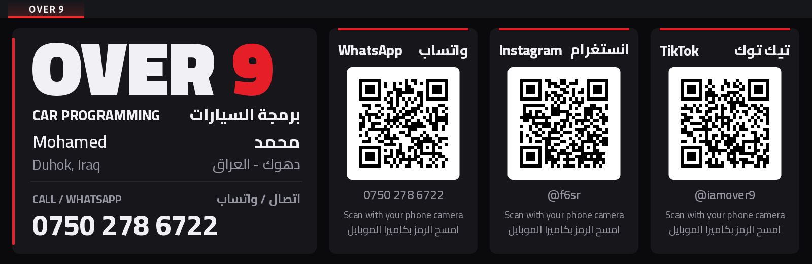
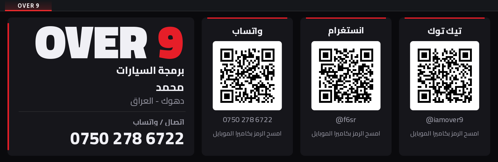
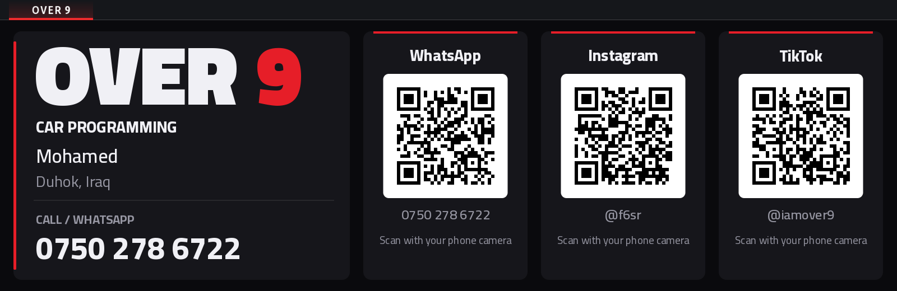

# OVER 9 — iDrive 7 app

بطاقة ورشة **OVER 9** على شاشة iDrive 7 (MGU): الاسم، الشغل، المدينة، رقم التلفون، و QR للواتساب والانستغرام والتيك توك الزبون يسكانه بكاميرة موبايله.

The OVER 9 workshop card on the BMW iDrive 7 (MGU) screen: name, service, city, phone and QR codes for WhatsApp,
Instagram and TikTok.



| عربي | English |
|---|---|
|  |  |

## التنصيب / Install

1. بالـ MGU Store لازم يكون مضاف `cauliflowermossgrape/idrive7-apps` (منه يجي الـ GPU renderer والـ controller gate).
2. ضيف هذا الـ repo كمصدر: GitHub ← `owner/repo` ← Add.
3. من COMPONENTS نصّب **OVER 9**. الوحدة تبنيه بنفسها.

## الإعدادات / Settings

- **Language**: عربي وإنگليزي / عربي / إنگليزي
- **Colour**: أحمر / أزرق / ذهبي

## تغيير المعلومات / Changing the details

The unit's fonts have no Arabic, so every line of text is drawn beforehand into `apps/over9/assets.js`.

1. عدّل `INFO` بأول `tools/gen_assets.py`.
2. شغّل:
   ```sh
   pip install pillow segno
   python3 tools/gen_assets.py
   ```
3. ارفع `version` بـ `apps/over9/app.json` (مثلاً 1.0.1) حتى الستور يشوف التحديث.

Preview without a car or SDK:

```sh
python3 kit/tools/build.py over9 --preview-only
node kit/tools/preview.js dist/over9 out wait=3 --set lang=both
```

## License

- The app (`apps/over9`, `tools/`): © 2026 OVER 9.
- The app kit (`kit/`): from [cauliflowermossgrape/idrive7-apps](https://github.com/cauliflowermossgrape/idrive7-apps), MIT (`kit/LICENSE`).
- Cairo font (`fonts/`): SIL Open Font License 1.1 (`fonts/OFL-Cairo.txt`).

Not affiliated with BMW. Use at your own risk.

## OVER 9 Reaction

اختبار ردة فعل مثل إشارات سباق الدراگ: اضغط حتى تبدي، 3 أصفر، وبعدها أخضر بوقت عشوائي، واضغط بأسرع وقت. إذا ضغطت قبل الأخضر تنحسب انطلاق خاطئ. يعرض الوقت بالملي ثانية، والترتيب، وأفضل 5 أوقات. يشتغل بس والسيارة واكفة.

A drag-strip start tree: reaction time in milliseconds, ranks and the five best times. Parked only.
Arabic text: `python3 tools/gen_reaction.py`.

## OVER 9 Talk

السيارة يصير إلها وجه وتحچي وياك بالعربي أو الكوردي (بادينى) أو الإنگليزي، حسب سياقتك: زيت بارد ودوران عالي، سرعة، إشارة منسية، وقوف طويل، زحمة، حرارة عالية، الليل، سياقة نظيفة. يقرا بس من السيارة وما يغيّر شي.

The car gets a face and comments on how it is driven, in Arabic, Kurdish (Badini) or English. Reads only.
Messages: `tools/gen_talk.py` (then `python3 tools/gen_talk.py`). Fonts: Cairo and Noto Sans Arabic (OFL, `fonts/`).
